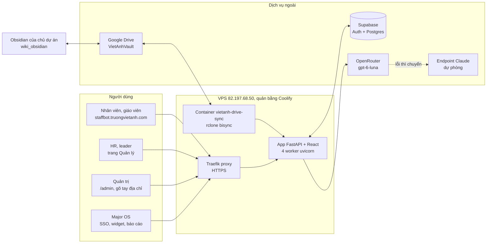
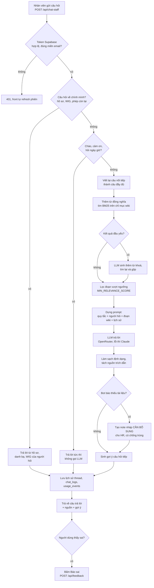
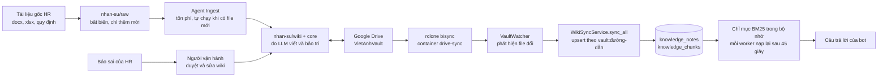
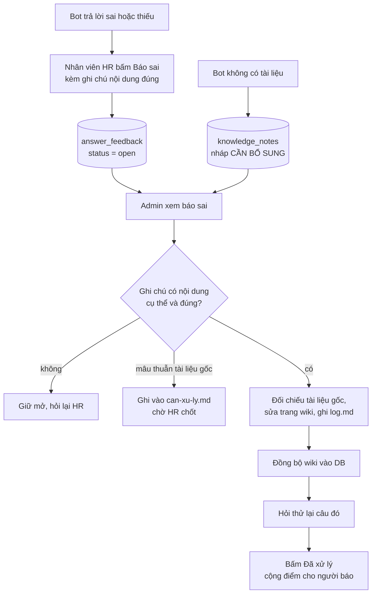
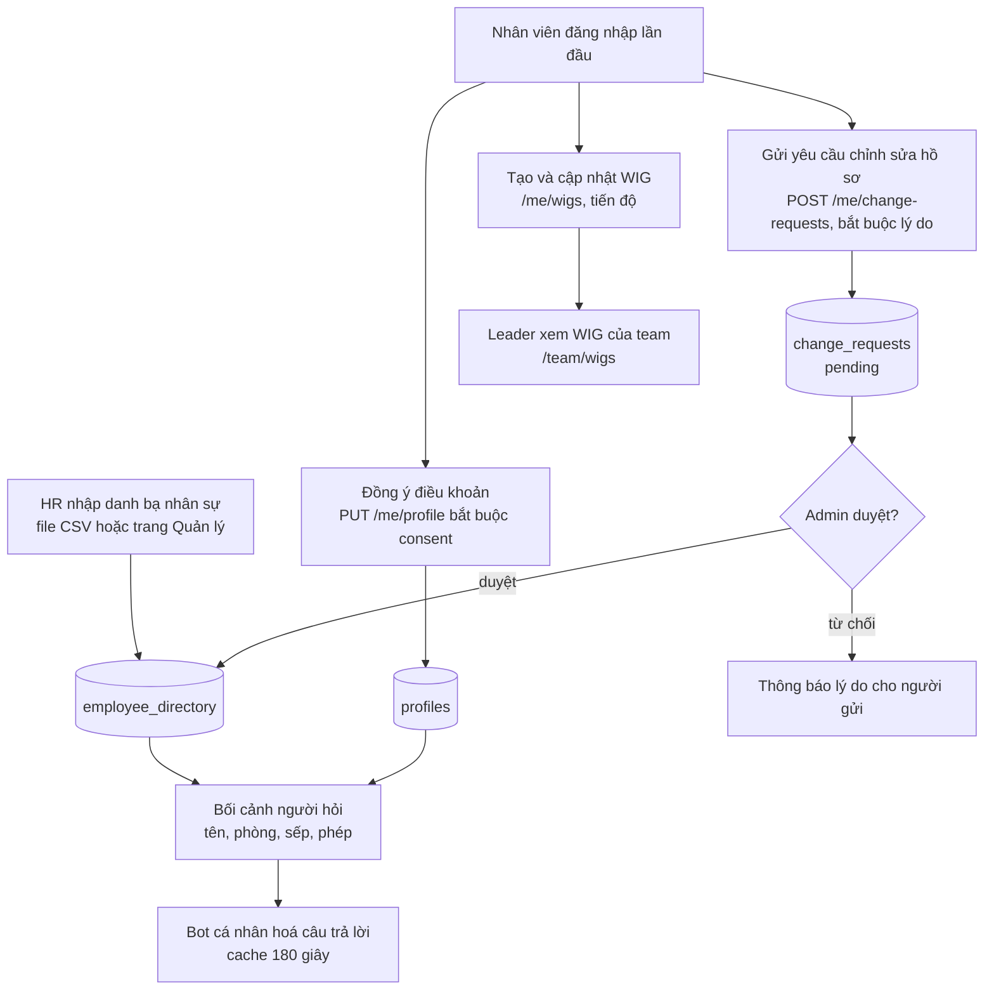
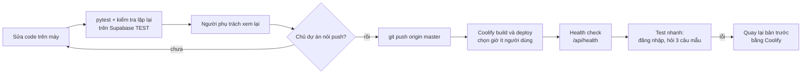

# Sơ đồ luồng — Trợ lý nội bộ Trường Việt Anh (Chatbot_staff)

Tài liệu này mô tả hệ thống đang chạy thật và danh sách việc cần làm tiếp. Các sơ đồ viết bằng Mermaid, xem được trong VS Code (bản xem trước Markdown có Mermaid), GitHub và Obsidian.

Cập nhật lần đầu: 2026-10-29.

## 1. Kiến trúc tổng quan

Điểm cần nhớ:
- Mọi dữ liệu người dùng (hồ sơ, WIG, lịch sử chat, báo sai) nằm trong Supabase. Wiki là nguồn tri thức, bản sao nằm trong Supabase để tìm kiếm.
- Quyết định 2026-10-29: dùng Supabase bản trả phí `bwgnjabitfrccezpppia` làm production lâu dài. Dự án thử `paebtebjgpsucthuehuo` bỏ qua, không chuyển.

## 2. Luồng một câu hỏi chat

## 3. Luồng dữ liệu: từ tài liệu gốc đến câu trả lời

Lưu ý vận hành:
- Không thêm tệp vào `raw/` nếu chưa chắc, vì VaultWatcher sẽ tự chạy agent Ingest tốn tiền.
- Đồng bộ Drive đang hỏng từ 15/10 (token OAuth hết hạn). Hiện đồng bộ wiki vào bot bằng tay. Xem mục 7.
- Trang đánh dấu `chatbot: false` không đưa vào bot.

## 4. Luồng báo sai và bổ sung dữ liệu

## 5. Luồng hồ sơ cá nhân, danh bạ và WIG

Hiện danh bạ có 0 dòng nên bot chưa cá nhân hoá được cho ai. Đây là việc ưu tiên số 1.

## 6. Luồng triển khai code (đang có người dùng thật)

Quy tắc: không push và không deploy khi chưa có lệnh của chủ dự án. Không để hai người cùng deploy một lúc (đã từng xảy ra tình trạng chồng deploy làm 503).

## 7. Kế hoạch việc cần làm

Trạng thái: ☐ chưa làm, ◐ đang làm trên máy (chưa push), ☑ xong.

### Nhóm 1 — Ảnh hưởng người dùng đang dùng
- ◐ Câu trả lời ổn định: nhiệt độ sinh câu trả lời về 0, quy tắc "có thông tin liên quan thì nêu, không từ chối hẳn" (`llm.py`, `prompt_builder.py`).
- ◐ Sửa nhận nhầm ý khi hỏi về sếp, quên mật khẩu email, câu hỏi hỗn hợp, WIG quá hạn (`routes.py`).
- ◐ Gợi ý câu hỏi sát chủ đề, trả lời nhanh "bạn là ai", mở rộng từ đồng nghĩa và viết tắt (`pipeline.py`, `suggestions.py`).
- ◐ Dọn dòng chỉ dẫn nội bộ lọt vào wiki, lập phiếu câu hỏi bot chưa trả lời được cho HR.
- ◐ Thông báo lỗi tiếng Việt trong form hồ sơ, tiêu đề thread khi chỉ chào, từ chối khoá lạ trong yêu cầu chỉnh sửa.
- ☐ HR gửi danh bạ nhân sự để nhập vào `employee_directory`. Có mẫu: `Mau-danh-ba-nhan-su.csv`.
- ☐ Bảo mật: đổi `ADMIN_TOKEN` (hiện 19 ký tự), xoá token API Coolify `claude-vault-setup`, đổi secret key và mật khẩu DB đã dán trong chat.

### Nhóm 2 — Tuần này
- ☐ Sửa đồng bộ Google Drive: Publish ứng dụng OAuth, chạy `rclone config reconnect gdrive:`, chép cấu hình lên VPS.
- ◐ Giám sát: đã viết `/api/health/deep`, `scripts/uptime_check.py`, mục "câu hỏi chưa trả lời được" trong trang admin. Chưa triển khai; cần đặt lịch chạy `uptime_check.py`.
- ◐ Bộ câu hỏi chuẩn (94 câu) và `scripts/eval_golden.py`: chạy sau mỗi lần sửa wiki hoặc trước khi deploy, xem `docs/quy-trinh-kiem-thu.md`.
- ☐ Tìm kiếm còn hụt 3 câu trong bộ chuẩn: khi nào xét tăng lương, giờ làm khối văn phòng, Chuyên viên C&B làm gì.
- ☐ Kiểm tra lịch sao lưu Supabase production.
- ◐ Cột người dùng cho `chat_logs`: code và file migration `20261029000000_chat_logs_user.sql` đã viết, chưa áp dụng vào DB.
- ☐ Thống nhất ai được deploy, quy ước giờ deploy.

### Nhóm 3 — Nội dung HR cần bổ sung
- ☐ Chốt năm tính phép (có 3 mốc: 1/6–31/5, 1/7–30/6, 1/8–31/7).
- ☐ Chốt việc hoàn tiền phép: nhân viên hay chỉ giáo viên.
- ☐ Mức thưởng giới thiệu học sinh, quy định riêng về thai sản, số điện thoại công ty, bảng xếp bậc khởi điểm, email các leader.
- ☐ Các chủ đề chưa có tài liệu: đi làm muộn, làm việc từ xa, intern, công tác phí, nội quy.
- ☐ Xử lý 9 báo sai của người thật đang mở.

### Nhóm 4 — Để sau
- ◐ Trả lời dạng stream: đã viết xong trên máy (`/api/chat-staff/stream`, tự rơi về cách cũ nếu lỗi); chưa thử trên trình duyệt và qua Cloudflare thật.
- ☑ Chuyển Supabase: huỷ, giữ bản trả phí hiện tại.
- ☐ Môi trường thử (staging) riêng.
- ☐ Quyết định có bắt buộc điền hồ sơ trước khi dùng không.

## 8. Tham chiếu nhanh

| Thành phần | Vị trí |
|---|---|
| Khởi động, lifespan, SSO, trang admin | `app/main.py` |
| Toàn bộ API | `app/api/routes.py` |
| Pipeline hỏi đáp | `app/rag/pipeline.py` |
| Tìm kiếm BM25 | `app/rag/lexical_store.py` |
| Prompt và quy tắc trả lời | `app/rag/prompt_builder.py` |
| Gợi ý câu hỏi tiếp | `app/rag/suggestions.py` |
| Gọi LLM và chuỗi dự phòng | `app/services/llm.py` |
| Đồng bộ wiki vào DB | `app/services/wiki_sync_service.py` |
| Theo dõi thư mục wiki | `app/services/vault_watcher.py` |
| Giao diện | `frontend/src/` |
| Cấu trúc bảng | `supabase/migrations/` |
| Đồng bộ Drive | `drive-sync/` |
| Hướng dẫn SSO Major OS | `docs/Huong_dan_SSO_Major_OS.md` |
| Wiki nguồn tri thức | `E:\Workspace\wiki_obsidian` (CLAUDE.md là hợp đồng vận hành) |

Các biến môi trường chính: `SUPABASE_*`, `OPENROUTER_*`, `LLM_*` (endpoint Claude dự phòng), `RETRIEVAL_MODE=lexical`, `ADMIN_TOKEN`, `VAULT_PATH`, `UVICORN_WORKERS`.
